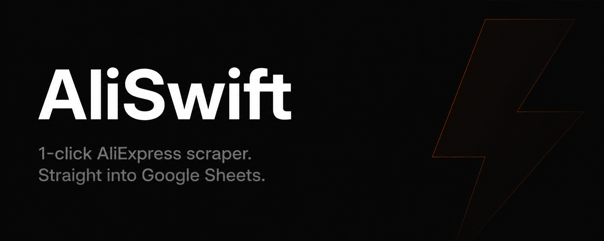
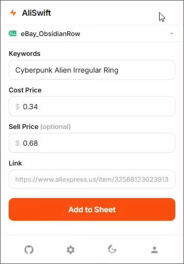
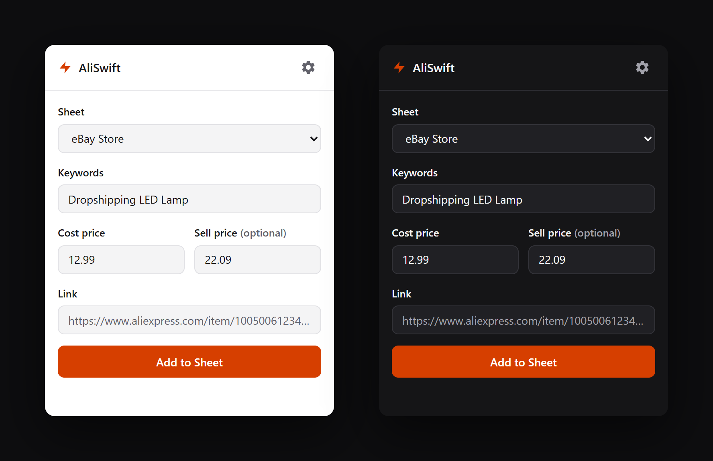
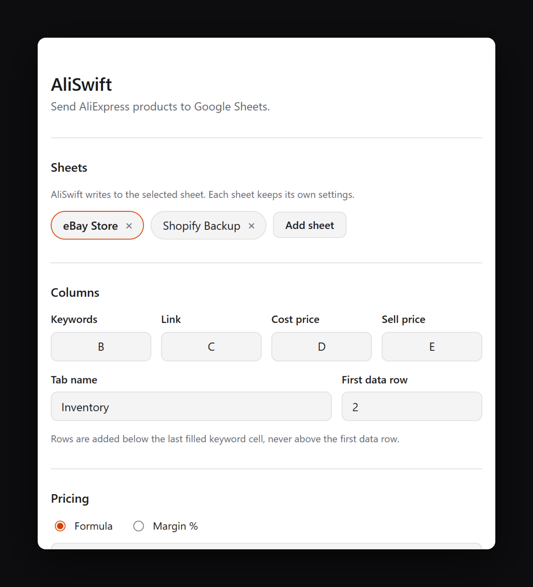
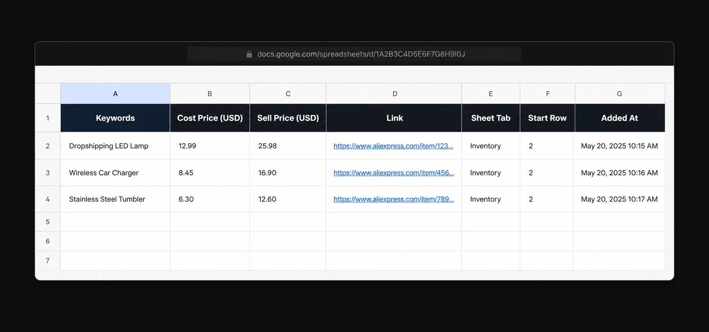
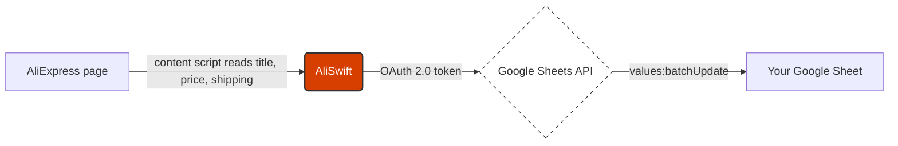

<div align="center">



[](https://github.com/envyxyz/aliswift/releases)
[](https://github.com/envyxyz/aliswift/actions/workflows/ci.yml)
[](LICENSE)
[](https://github.com/envyxyz/aliswift/releases)
[](https://developers.google.com/sheets)
[](https://github.com/envyxyz/aliswift/stargazers)

**Save AliExpress products to Google Sheets in one click**



</div>

---

## Overview

AliSwift is a Chrome extension for eBay and Shopify dropshippers who source from AliExpress. Instead of copying a product's title, price and link by hand, you click one button and the row lands in your Google Sheet, already priced.

You can keep several sheets, each with its own column layout and pricing rules. It is plain JavaScript on Chrome Manifest V3, with no build step, no dependencies, no servers and no account to create.

## Features

- **One click** from the green button on the product page, or from the toolbar popup
- **Auto sheets**: AliSwift creates a Google Sheet for you, set up for eBay UK or eBay US with fee, profit and margin formulas, status lists and an Orders tab
- **Multiple sheets**, each with its own columns, tab name and pricing
- **SKUs** added with each product, matching the numbering of the sheet it creates
- **Settings backup**: export and import your sheets and settings as a file
- **Formula or margin pricing**, for example `costPrice * 1.7` or `(costPrice + 2) * 1.5`
- **Landed cost**: item price, plus shipping when the page shows it, plus an extra cost you set
- **.99 rounding** for sell prices (4.77 becomes 4.99)
- **Title cleanup**: cap the word count and drop noise words like "wholesale" or "lot"
- **Safe writes**: titles go into the sheet as plain text, so a seller cannot sneak a spreadsheet formula into your sheet
- **Light and dark** theme that follows your system
- **Private**: no tracking, no analytics, nothing leaves your browser except the write to your own sheet ([details](PRIVACY.md))

## Screenshots

**Popup**


**Settings**


**Result in Google Sheets**


## Install

AliSwift is not on the Chrome Web Store yet. Installing by hand takes about a minute.

**From a release (recommended)**

1. Download the latest zip from [Releases](https://github.com/envyxyz/aliswift/releases) and unzip it. You get a folder named `aliswift`.
2. Open `chrome://extensions` and turn on **Developer mode** (top right).
3. Click **Load unpacked** and pick the `aliswift` folder.
4. Pin AliSwift from the puzzle-piece menu so the icon is always visible.

**From source**

```
git clone https://github.com/envyxyz/aliswift.git
```

Then do steps 2 to 4 above and pick the cloned folder. There is nothing to build.

## Set up

**Auto (easiest).** Open AliSwift settings (gear icon in the popup), click **Add sheet** and keep **Auto** selected. Give the sheet a name, pick eBay UK or eBay US, and type the currency you spend in (for example PKR). Click **Create sheet**. AliSwift creates a Google Sheet in your Drive with Dashboard, Inventory and Orders tabs and adds it for you. There are no columns to set. Then open the **Pricing** tab and pick formula or margin pricing. The fee rates sit in the Inventory tab's hidden row 1 (unhide row 1 and columns G to I to edit them); the international fee and tax rates are defaults, so check them against a real order's fee breakdown. The exchange rate cell is on the Dashboard tab (unhide rows 1 to 4).

**Manual (a sheet you already have).**

1. Create a Google Sheet. It has to be a native Google Sheet, not an uploaded `.xlsx` file.
2. Open AliSwift settings, click **Add sheet**, and switch to **Manual**.
3. Paste the sheet's link, give it a name, and type the sheet tab (for example `Inventory`).
4. Click the pencil next to the sheet and check the column letters match your sheet. Defaults: keywords in B, link in C, cost price in D, sell price in E. **Use AliSwift template layout** fills every field for a sheet shaped like the Auto one.
5. Open the **Pricing** tab and pick formula or margin pricing. Settings save as you change them.

**Moving to another computer.** On the **General** tab, **Export settings** saves your sheets and settings to `aliswift-settings.json`. **Import settings** loads that file. Your sheets themselves live in Google Sheets and are not part of the file.

**Updating from an older build.** The sign-in key was rotated, so the extension ID changed and Chrome treats the new build as a new extension with empty settings. Export your settings before updating, then import them and sign in again. Your sheets are not affected.

The first time you add a product, Google asks you to let AliSwift edit your spreadsheets. If Google shows an "unverified app" screen, pick **Advanced**, then continue. You can run your own sign-in client instead; see [CONTRIBUTING](CONTRIBUTING.md#google-sign-in-for-your-own-build).

## Usage

1. Open an AliExpress product page.
2. Click the green **Add to Sheet** button on the page, or click the AliSwift icon, check the values, and press **Add to Sheet**.
3. The row is written below the last filled keyword in your sheet. If the sheet has a SKU column, the button shows the SKU it was given, for example "Added as SKU-31".

AliSwift only ever writes into the next free row. It never deletes rows or clears cells.

To switch sheets, use the dropdown in the popup or click another sheet on the Sheets tab. Prices are recalculated with that sheet's rules.

## How prices are calculated

```
cost price = item price + shipping (if the page shows it) + extra cost
sell price = formula(cost price)   or   cost price x (1 + margin / 100)
```

AliSwift copies the number AliExpress shows and does no currency conversion. Set your AliExpress currency to the one your sheet uses.

## Known issues

- **Shipping detection is limited.** Only shipping costs written on the page are picked up. If AliExpress says "free shipping over $X" or hides the cost until checkout, nothing is added. Use **Extra cost** as a manual fallback.
- **Native Google Sheets only.** The Sheets API cannot write to `.xlsx` files stored in Drive. Use File > Save as Google Sheets first.
- **Needs a signed-in Chrome profile.** Sign-in uses `chrome.identity`, which works with the Google account your Chrome profile is signed into.
- **AliExpress changes its pages.** If the title or price stops scraping, [open an issue](https://github.com/envyxyz/aliswift/issues/new/choose) with the product URL. The selectors are the constants at the top of `content.js`.

## Roadmap

- Chrome Web Store release
- Bulk scrape from search and category pages
- Image URL scraping
- Firefox support

## Contributing

Bug reports, scraping fixes and pull requests are welcome. [CONTRIBUTING.md](CONTRIBUTING.md) covers running it locally, the tests, and how releases are cut. Changes are listed in [CHANGELOG.md](CHANGELOG.md). Report security problems privately, see [SECURITY.md](SECURITY.md).

## How it works

A content script reads the product page and calculates the prices. The service worker holds the Google token and talks to the Sheets API. The popup and settings page are plain HTML.



## Author

Built by [ameer<3](https://github.com/envyxyz)

[](https://github.com/envyxyz)

## License

MIT License. See [LICENSE](LICENSE) for details.

---

<div align="center">

If AliSwift saves you time, consider leaving a star.

[](https://github.com/envyxyz/aliswift/stargazers)

</div>
