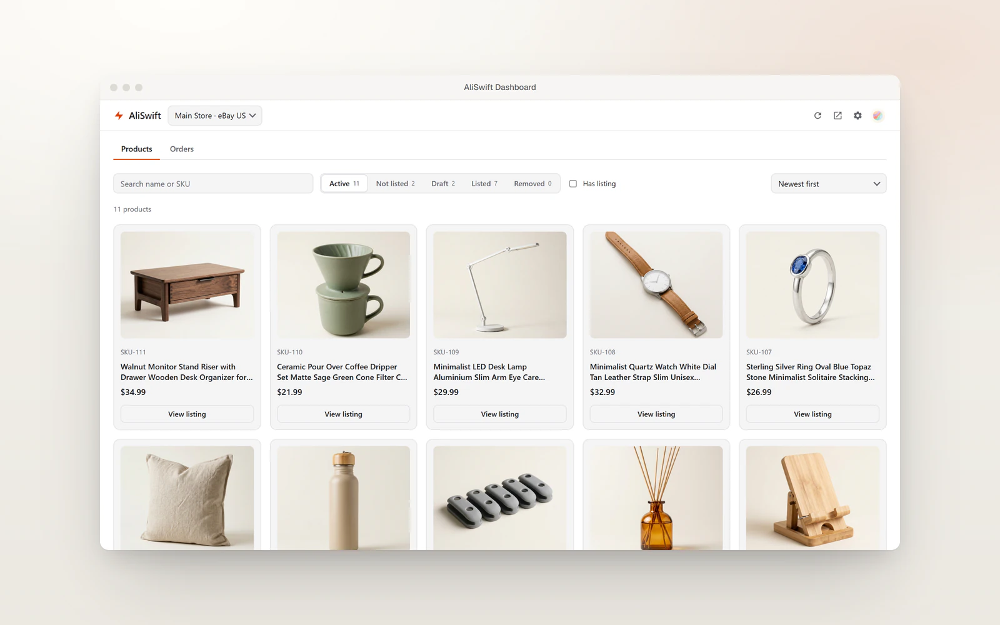
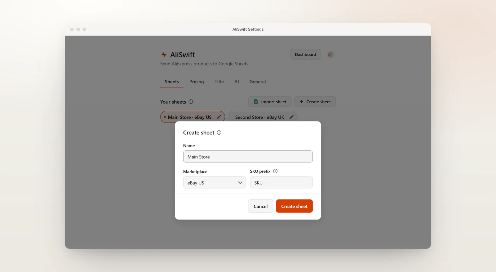
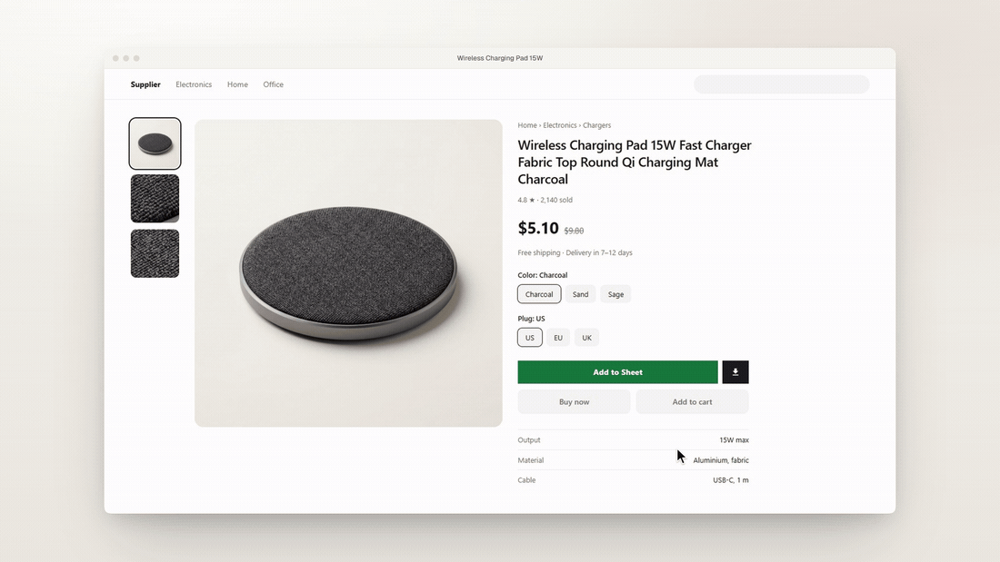
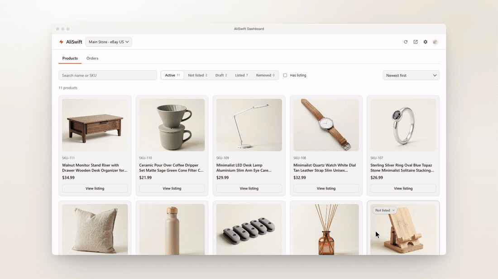
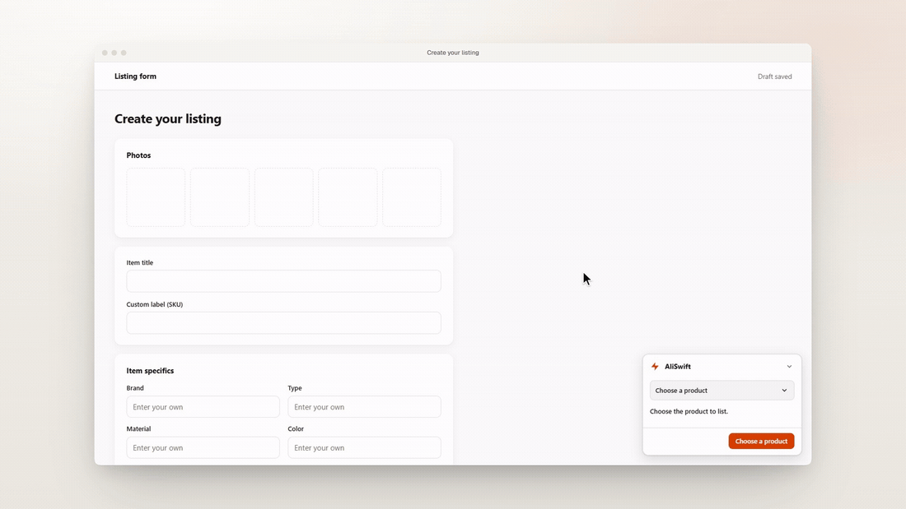
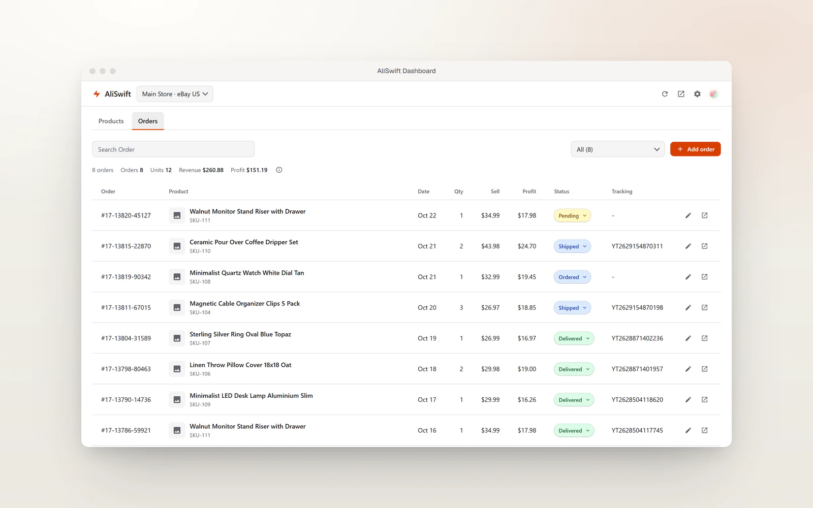

# AliSwift

**From AliExpress to a finished eBay listing, without the copy and paste.**

A free Chrome extension for dropshippers. Save products to Google Sheets with your sell price worked out, 
let AI write the listing with your own key, and have eBay's listing form filled for you.

[Install](#install) · [Walkthrough](#walkthrough) · [FAQ](docs/faq.md) · [Privacy](PRIVACY.md) · [Roadmap](ROADMAP.md)

 

<picture>
  <source media="(prefers-color-scheme: dark)" srcset="screenshots/hero-dark.webp">
  
</picture>

Screenshots and recordings use a demo store.

## Install

AliSwift isn't on the Chrome Web Store yet, so Chrome loads it from a folder. It takes about two minutes.

**Windows, with automatic updates**

1. Download [setup-updates.bat](https://github.com/envyxyz/aliswift/releases/latest/download/setup-updates.bat) and run it. It copies the extension to `%LOCALAPPDATA%\AliSwift\extension` and opens that folder.
2. Go to `chrome://extensions`, switch on **Developer mode** (top right) and click **Load unpacked**.
3. Pick the folder the script opened, then pin AliSwift from Chrome's extensions menu.

After that you're done for good: a scheduled task checks for a new release when you sign in to Windows and every hour after, and the extension reloads itself within a minute of an update. Your settings and keys stay put. To stop the checks, run `powershell -ExecutionPolicy Bypass -File "%LOCALAPPDATA%\AliSwift\update.ps1" -Unschedule`.

**macOS, Linux, or by hand**

Download the zip from the [latest release](https://github.com/envyxyz/aliswift/releases/latest), unzip it, and load the folder with **Load unpacked** as above. To update, unzip the new release over the same folder and press the reload arrow on AliSwift's card in `chrome://extensions`.

Already running AliSwift from another folder?

Run `setup-updates.bat "C:\path\to\that\folder"` so that folder is the one kept up to date. Removing an extension from Chrome deletes its stored data, so don't remove and re-add it.

## Walkthrough

### 1. Connect a sheet

Click the AliSwift icon and open Settings. **Create sheet** builds a spreadsheet in your Google Drive for the marketplace you sell on (eBay US, UK, Global, Germany, Australia or Canada), with fee, profit and margin formulas, status menus and an Orders tab already set up. Already keep a sheet? **Import sheet** reads its headers and maps the columns for you.

Signing in is optional. Without it, products save to a library on your device, and you can move them into a sheet whenever you like.

<picture>
  <source media="(prefers-color-scheme: dark)" srcset="screenshots/create-sheet-dark.webp">
  
</picture>

### 2. Save products from AliExpress

Open any AliExpress product and press **Add to Sheet** under the price, or use the toolbar popup. AliSwift reads the title, price, shipping, photos and buyer options, converts the currency at the live rate, and applies your pricing rule: a formula like `(costPrice + 2) * 2.2` or a target margin, with optional .99 endings. The product lands in the next free row with its own SKU.

Press the button again on a saved product and it offers **Remove from Sheet**, which clears only the cells AliSwift wrote.

<picture>
  <source media="(prefers-color-scheme: dark)" srcset="screenshots/save-dark.gif">
  
</picture>

### 3. Let AI write the listing

Add an AI key under Settings, AI. Gemini has a free tier and is the one that reads product photos; Groq and OpenRouter work too. About a minute after you save a product, AliSwift writes its eBay title (80 characters at most), description and item specifics in the background.

Click any card on the dashboard to see its cost, eBay fees, profit and margin next to the listing, which you can edit, copy or rewrite. With several keys, free ones go first and a busy key hands over to the next.

<picture>
  <source media="(prefers-color-scheme: dark)" srcset="screenshots/listing-dark.gif">
  
</picture>

### 4. Fill eBay's listing form

Start a listing on eBay and choose its category. The AliSwift panel in the corner lists your products that have a listing; pick one and press **Fill form**. It switches the format to Buy It Now and fills the title, custom label (SKU), description, price and item specifics. Anything it can't fill safely becomes a copy button. It never presses **List it**, so you always check and publish yourself.

For photos, press **Add from AliExpress** under eBay's uploader and pick from the product's gallery and variant photos. AliSwift saves them to your Downloads folder and adds them to the listing.

<picture>
  <source media="(prefers-color-scheme: dark)" srcset="screenshots/fill-dark.gif">
  
</picture>

### 5. Keep track of orders

On Seller Hub's order list, **Add all orders to sheet** copies new orders into your Orders tab. It matches on order number and SKU, so running it twice never adds an order twice. The dashboard's Orders view shows each order's status, tracking, profit and a link back to eBay.

<picture>
  <source media="(prefers-color-scheme: dark)" srcset="screenshots/orders-dark.webp">
  
</picture>

## Privacy

Your products and orders live in your own Google Sheet and in Chrome's storage on your computer. AI keys never leave your device except to go to their own provider. To help fix problems, AliSwift sends error reports (failure codes, timings and crash traces, never your keys, sheet names, products or orders) to the developer's diagnostics service. They're on by default and you can switch them off in Settings, General. [PRIVACY.md](PRIVACY.md) lists exactly what goes where.

## What's next

eBay comes first, and Etsy and Temu support is on the way. Got an idea, or want to help build one of those? [Open an issue](https://github.com/envyxyz/aliswift/issues/new/choose) or read the [roadmap](ROADMAP.md).

## Contributing

Bug reports and pull requests are welcome. AliSwift is plain JavaScript with no build step and no dependencies, and `npm test` runs the whole suite. [CONTRIBUTING.md](CONTRIBUTING.md) explains the layout and the few rules.

## License

Free for personal use, including running your own store with it. Selling AliSwift, making money from it, or publishing it on any store or platform needs written permission first: [open an issue](https://github.com/envyxyz/aliswift/issues) to ask. See [LICENSE](LICENSE).

AliSwift isn't affiliated with or endorsed by AliExpress, eBay or Google.
